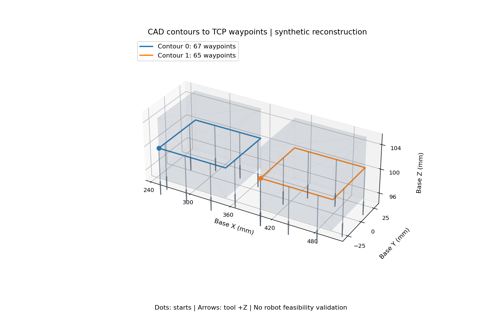
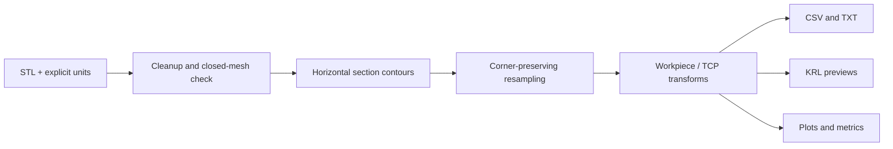

# CAD-to-Robot Offline Programming

A Python reconstruction of a CAD-based offline robot programming workflow, motivated by a May–August 2021 robotics internship at Larsen & Toubro. It turns STL cross-section contours into ordered Cartesian TCP poses, applies workpiece and tool transforms, and produces inspectable plots, CSV/TXT waypoints, and non-executing KRL previews.

During my internship at L&T, I worked on a similar CAD-based offline programming workflow. This repository presents a small-scale reconstruction of its geometry and export stages using synthetic examples. It does not provide KR 4 R600 inverse kinematics, collision/singularity checks, executable welding programs, or hardware-validated results.

[Detailed project guide](docs/guide.md) · [Technical report](docs/technical_report.md) · [Internship certificate](docs/certificate.pdf) · [Saved examples](examples/results/)



## What this implementation does

- Loads ASCII/binary STL with explicit metre or millimetre input units.
- Merges coincident vertices, removes duplicate/degenerate faces, and rejects meshes that remain open.
- Extracts closed contours at a selected horizontal section plane.
- Preserves corners and disconnected loops while limiting Cartesian segment spacing.
- Applies workpiece-to-base transforms and computes flange poses from a defined TCP offset.
- Exports separate contour IDs, plots tool directions, and records input hashes and parameters.
- Generates `.SRC`/`.DAT` previews with all motion commands commented out.

These are candidate contours for inspection, not automatically identified weld seams. Welding joint selection, surface normals, lead/travel angles, and process settings require additional inputs.



## Outputs

| File | Meaning |
|---|---|
| `waypoints.csv` | Path/point IDs and TCP XYZABC in robot-base coordinates |
| `waypoints.txt` | Same poses in a documented text representation |
| `CONTOUR_###.SRC` | One non-executing preview per contour; commented `LIN` statements |
| `CONTOUR_###.DAT` | Cartesian FRAME data; no inferred S/T configuration |
| `paths.png` | Mesh, path starts, contours, and tool +Z directions |
| `metrics.json` | Input hash, transforms, lengths, spacing, and validation status |

The output directory must be new or empty. Existing results are never silently overwritten. Use a fresh directory for each run.

## Measured reconstruction results

| Synthetic fixture | Paths | Waypoints | Total path length |
|---|---:|---:|---:|
| 100 × 60 × 10 mm plate | 1 | 67 | 320.000 mm |
| Two separated plates | 2 | 132 | 640.000 mm |
| Radius 40 mm, 64-sided cylinder | 1 | 129 | 251.226493 mm |

All use a section at Z=0 and maximum spacing 5 mm. The cylinder approximates an ideal circular circumference with about 0.0402% length error. Waypoint counts include closure points and retained triangulation intersections. These are geometric software measurements, not robot accuracy or welding-quality measurements. See [methodology and results](docs/technical_report.md).

## Project layout

```text
src/cad_to_robot/    Geometry, frame transforms, exporters, CLI
tests/               Analytic geometry and export checks
examples/meshes/     Original synthetic STL fixtures
examples/results/    Saved plots, metrics, and previews
docs/                Project guide, technical report, and internship certificate
.github/workflows/   GitHub Actions test and demo workflow
```

## Remaining robot-specific work

Accurate KR 4 R600 joint transforms, limits, controller version, TCP/load calibration, cell geometry, and process details are needed before adding validated IK, configuration selection, collision checking, singularity analysis, motion timing, or executable KRL. Nominal reach is not a reachability test. KUKA.Sim/DELMIA integration and hardware testing have not been reproduced.

Next engineering milestone: obtain an authoritative robot model and controller documentation, then validate frame conventions and candidate paths in an appropriately configured simulator. Reconstructed results must continue to be reported separately from historical internship activities.

## References

- [KUKA KR 4 AGILUS specifications](https://www.kuka.com/en-sg/products/robotics-systems/industrial-robots/kr-4-agilus): current product table lists six axes, 4 kg load, and 601 mm reach; it does not identify the historical controller.
- [KUKA.Sim features](https://www.kuka.com/en-gb/products/robotics-systems/software/simulation-planning-optimization/kuka_sim/kuka_sim_updates): commercial simulation and welding capabilities are context, not implemented features here.
- [Trimesh API documentation](https://trimesh.org/trimesh.html): mesh loading, processing, and plane sections. Runtime version is pinned because online documentation may describe newer releases.
