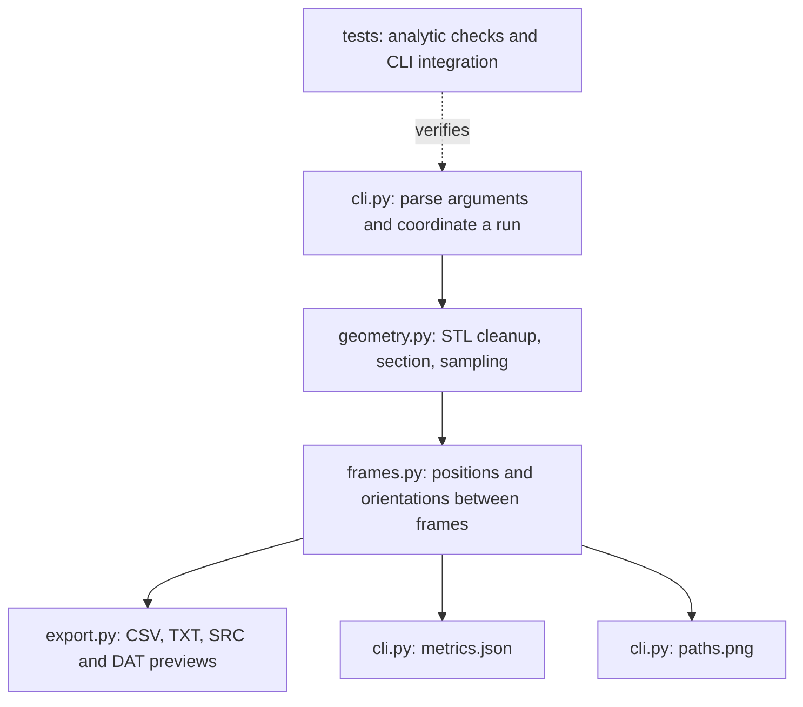

# Learn the project, from CAD geometry to robot waypoints

Read this guide with `src/cad_to_robot/` open beside it. All code discussed here is implemented unless explicitly marked as future work.

## 1. What problem are we solving?

A CAD model describes a part. A robot needs instructions describing where its tool should go and how it should be oriented. Those are different representations. This repository implements the conversion from a restricted form of CAD geometry into candidate Cartesian tool paths.

The motivating application is offline programming for welding. Offline means preparing a program on a computer rather than teaching every point at the physical robot. This implementation handles the geometric preparation and export stages.

Three terms matter:

- A **point** is a position, such as `(50, 30, 0)` mm.
- A **pose** is a position plus an orientation.
- A **trajectory** describes motion over time. Our outputs are ordered poses, not time-parameterized trajectories.

## 2. Architecture and responsibilities



The library functions hold the calculations; the command line interface coordinates them. This separation means you can later call the geometry functions from a notebook or graphical interface without rewriting their mathematics.

## 3. Technologies and why each is used

| Technology | Concrete job in this repository |
|---|---|
| Python | CLI, orchestration, file handling, packaging and tests |
| NumPy | Vectorized arrays, segment lengths, interpolation, matrices and matrix multiplication |
| Trimesh | STL reading, mesh representation, cleanup and plane intersections |
| NetworkX | Graph traversal used by Trimesh to assemble section segments into closed paths |
| SciPy Rotation | Euler-angle/matrix conversion without manually coding every rotation formula |
| Matplotlib | Saved 3D plots with mesh surfaces, contour lines and tool directions |
| pytest | Analytic, invalid-input, export and end-to-end regression checks |
| setuptools and pyproject.toml | Install the package and expose `cad-to-robot` as a command |
| GitHub Actions | Install dependencies, run tests and generate a demo on pushes and pull requests |
| CSV, JSON, TXT | Portable data interchange and a machine-readable run record |

KUKA.Sim and DELMIA are historical workflow context, not package dependencies. KRL is represented only by preview files. Machine learning is not required: these operations are geometric calculations with known inputs and formulas.

## 4. Repository map

| File or directory | Read it to understand |
|---|---|
| `README.md` | Project purpose, scope, workflow, example results, and documentation links |
| `pyproject.toml` | Package metadata, dependency ranges, CLI entry point and test discovery |
| `requirements.txt` | Direct dependency versions used for validation |
| `src/cad_to_robot/__init__.py` | Package description and version |
| `src/cad_to_robot/geometry.py` | STL-to-polyline processing |
| `src/cad_to_robot/frames.py` | Coordinate transforms and pose construction |
| `src/cad_to_robot/export.py` | Output schemas and KRL preview formatting |
| `src/cad_to_robot/cli.py` | Main execution flow, metrics and visualization |
| `examples/generate_fixtures.py` | Rebuild the synthetic input meshes |
| `examples/run_all.py` | Run all three examples in new directories, leaving recorded outputs intact |
| `examples/meshes/` | Three small STL inputs |
| `examples/results/` | Saved example exports, plots and measured metrics |
| `tests/test_pipeline.py` | Independent mathematical expectations and export checks |
| `tests/test_cli.py` | Full command execution and robustness checks |
| `docs/technical_report.md` | Methods, equations, experiments and limitations |
| `.github/workflows/tests.yml` | Automated verification configuration |
| `.gitignore` | Keeps environments, caches and local output runs out of uploads |

## 5. Mesh import and cleanup: `geometry.load_stl`

STL stores a surface as triangles. The mesh has vertices (XYZ coordinates) and faces (indices identifying three vertices). It does not preserve the original SolidWorks feature tree, design constraints, material, or semantic weld edges.

`load_stl(path, units)` performs these steps:

1. Require `.stl` input and an explicit `mm` or `m` unit argument.
2. Load triangles and reject empty meshes or nonfinite coordinates.
3. Convert metres to millimetres by multiplying coordinates by 1000.
4. Merge coincident vertices, remove duplicate and degenerate faces, and remove unused vertices.
5. Require a watertight mesh after cleanup.

Watertight means the surface is closed at its mesh edges. It does not establish that the shape is manufacturable or free of self-intersections. Open sheet-metal models are outside this version's accepted input class. We reject them rather than invent missing surfaces.

## 6. Contour extraction: `geometry.section_contours`

The user supplies `--z`, a horizontal plane height in workpiece coordinates. Intersecting this plane with each triangle creates line segments. Trimesh joins those segments into polylines.

The function checks that the plane lies strictly inside the mesh's overall Z bounds, asks Trimesh for the section, and rejects missing or open contour results. Each closed contour is normalized to a lexicographic starting point and counterclockwise XY ordering. Separate loops remain separate.

For the plate fixture, the mesh extends from Z=-5 to Z=5 mm. A section at Z=0 produces a 100 by 60 mm rectangle. It is a mid-height geometric contour; it is not automatically a real welding joint. The algorithm does not decide whether a contour should be welded.

The two-plate fixture yields two loops. Joining the end of one directly to the start of the other would create an unplanned transfer move. The exporter therefore uses different path IDs and separate KRL preview modules.

## 7. Sampling: `geometry.resample`

A polyline may contain segments too long for the requested waypoint density. For segment endpoints `a` and `b`:

```text
L = norm(b - a)
n = ceil(L / maximum_spacing)
p(k) = a + (k / n) * (b - a),  k = 0 ... n-1
```

The next segment supplies its shared corner; the final endpoint is appended once. A 12 mm segment with a 5 mm limit uses three 4 mm subdivisions. The limit is a maximum, not an instruction to force every gap to exactly 5 mm.

Each original corner survives because sampling happens independently per segment. Sampling globally and connecting points across a corner could cut across the part. Zero-length repeated segments are skipped; zero-length paths, invalid spacing and excessive sample counts are rejected.

The plate perimeter is `2*(100+60)=320` mm. Its saved sample count includes the closing point and points introduced by triangulation intersections. More waypoints do not necessarily mean better geometry: they may simply reflect a denser tessellation.

## 8. Coordinate systems: `frames.py`

The same physical point has different coordinates depending on the chosen origin and axes. This project uses:

- **Workpiece frame:** the coordinate system of the imported mesh.
- **Robot-base frame:** the coordinate system used for exported TCP positions.
- **Flange frame:** the mounting interface where the tool is attached.
- **TCP frame:** tool centre point, such as an idealized torch tip.

A homogeneous transform is a 4 by 4 matrix:

```text
T = [ R  t ]
    [ 0  1 ]
```

`R` is a 3 by 3 rotation, and `t` is translation. For column vectors, `T_A_B` maps a point expressed in B into A. Rotation columns form an orthonormal, right-handed basis. `validate_frame` checks shape, finiteness, the final row, orthonormality and determinant +1.

`frame(xyz, abc)` constructs a transform. Angles follow `Rz(A) @ Ry(B) @ Rx(C)` in degrees. Order matters: rotating about X then Z generally differs from rotating about Z then X.

`tcp_poses` combines the workpiece pose with each local point and a constant local tool orientation:

```text
T_base_tcp = T_base_workpiece @ T_workpiece_tcp
```

With no base rotation and base translation `(300,0,100)`, local point `(50,30,0)` becomes `(350,30,100)`. With the test's 90-degree Z rotation, local `(10,0,0)` becomes a +10 mm Y displacement before translation.

## 9. Tool offset and flange poses

The TCP is usually displaced from the flange. `--tool-xyz` and `--tool-abc` define `T_flange_tcp`, the TCP frame expressed relative to the flange.

```text
T_base_flange = T_base_tcp @ inverse(T_flange_tcp)
```

For a downward-pointing tool and a 50 mm offset along tool/flange +Z with no relative tool rotation, placing the TCP at base Z=100 mm puts the flange at Z=150 mm. This is why blindly subtracting 50 from base Z is wrong: offset direction depends on orientation.

`flange_poses` computes these transforms; metrics record their bounds. Export files contain TCP poses, not flange poses. These calculations are rigid frame transformations, not robot forward or inverse kinematics.

`xyzabc` converts a transform back to position and Euler angles. Different angle triples can represent the same orientation, especially at Euler gimbal lock. A rotation matrix comparison is more useful than expecting identical angle numbers. Euler gimbal lock is not the same thing as a robot joint singularity.

## 10. Export formats: `export.py`

The output directory must be new or empty. This prevents an old second contour file from surviving a new single-contour run. Validation happens before writing pose data.

`waypoints.csv` contains `path_id, point_id, x_mm, y_mm, z_mm, a_deg, b_deg, c_deg`. CSV is convenient for spreadsheets, downstream scripts and inspection. `waypoints.txt` has a units/frame header and space-separated values; numeric values use six decimal places.

Each contour receives matching `.SRC` and `.DAT` names. `.DAT` holds named Cartesian FRAME values. `.SRC` shows the corresponding `LIN` statements as comments. These illustrate the relationship between point data and motion commands.

A real controller program additionally needs a verified controller dialect, initialization, base/tool assignment, robot configuration, approach/retreat and transfer moves, motion settings and welding process logic.

## 11. Orchestration and workflow: `cli.py`

`main()` defines arguments, reads the command line, calls `run()`, and presents input/file errors as CLI errors. `run()` loads the mesh, extracts contours, resamples them, constructs TCP and flange poses, exports the paths, computes metrics, and saves a plot.

Example:

```text
cad-to-robot examples/meshes/plate.stl --units mm --z 0 --spacing 5 --output output/lesson1
```

Read it as: load this STL as millimetres, slice at local Z=0, limit segment spacing to 5 mm, and save into a new run directory. Defaults place the workpiece at base `(300,0,100)` mm and point tool +Z downward. These are demonstration settings, not measured calibration.

The script never connects to a robot or calls KUKA.Sim/DELMIA. For another run, choose `output/lesson2` so the earlier run remains inspectable.

All command-line parameters are:

| Argument | Default | Interpretation |
|---|---|---|
| `mesh` | Required | Input STL path |
| `--units` | Required | `mm` or `m` for source coordinates |
| `--z` | Required | Interior section height in workpiece millimetres |
| `--spacing` | 5 | Maximum segment spacing in mm |
| `--base-xyz` | 300 0 100 | Workpiece origin expressed in robot-base mm |
| `--base-abc` | 0 0 0 | Workpiece orientation relative to robot base, degrees |
| `--tool-xyz` | 0 0 50 | TCP origin expressed in flange mm |
| `--tool-abc` | 0 0 0 | TCP orientation relative to flange, degrees |
| `--orientation` | 0 0 180 | Desired TCP orientation relative to workpiece, degrees |
| `--output` | output/demo | A new or empty result directory |

`--tool-abc` describes how the tool is mounted. `--orientation` describes how you want its TCP oriented along this path. They are different transforms.

## 12. Visualization and metrics

The translucent triangles show the mesh; coloured lines show TCP contours; dots show path starts; arrows show tool +Z. Axes are in robot-base millimetres. The display proportions can emphasize a thin Z dimension for readability, so use labelled coordinates for measurement.

`metrics.json` includes source-file SHA-256, Python/package versions, units, transforms, section height, spacing setting, path count, waypoint counts, lengths, maximum steps and flange-position bounds. Hashing links a run to exact input bytes.

The robot-validation flags are false because no such checks have run. They are not failed collision tests; they mean the checks are absent.

## 13. Experiments and how to interpret results

The three fixtures were chosen because they have independent expected answers:

- Rectangle: analytic perimeter 320 mm.
- Two rectangles: two separate 320 mm paths with no connecting segment.
- 64-sided cylinder: polygon perimeter `2*n*r*sin(pi/n)`, close to but less than the true circle `2*pi*r`.

The cylinder result is about 251.226493 mm, compared with 251.327412 mm for the ideal circle. Approximately 0.0402% length difference comes from the polygon approximation.

## 14. Tests and continuous integration

`test_pipeline.py` checks numerical behavior using analytic expectations: perimeter, corners, spacing, separate loops, known frame transformations and tool offsets. It also tests bad inputs and export contents.

`test_cli.py` launches Python as a subprocess. That exercises the complete file-to-output flow, confirms metrics and files, checks that a second run cannot overwrite the first, and checks missing input handling. Other cases reject near-rigid scaling, empty exports and excessive sampling.

Run `python -m pytest -q`. Tests verify the software's defined contracts, not a robot or welding process. GitHub Actions runs the same tests and builds a demonstration after upload; local success does not mean the remote workflow has already run.

## 15. Packaging and reproducibility

`pyproject.toml` declares package metadata and the entry point `cad-to-robot = cad_to_robot.cli:main`. Installing with `pip install -e .` exposes the command while keeping source edits active. The `src` layout separates importable code from examples and tests.

The supported dependency ranges are in `pyproject.toml`; the recorded dependency snapshot is in `requirements.txt`. For the recorded environment, install `requirements.txt` before installing the project. Compare numeric metrics with tolerances.

## 16. What a complete industrial workflow would add

**Forward kinematics** maps joint angles to the flange pose using the robot's actual joint geometry. **Inverse kinematics** finds joint configurations producing a desired pose, potentially with multiple solutions. This repository implements neither for the KR 4 R600.

**Reachability** depends on geometry, joint limits, orientation and tool offset, not simply whether a point lies inside a sphere of nominal reach. **Collision checking** needs robot-link, tool, part and fixture geometry throughout motion, not only at endpoints. **Singularity analysis** examines how joint motion maps to tool motion, often using a Jacobian. **Time parameterization** considers velocity, acceleration and controller behavior.

A welding workflow must also establish actual seams, joint type, lead/travel angles, standoff, process equipment, process parameters, approach/retreat moves and welding I/O. Simulator validation requires a correctly configured digital cell; physical validation requires the real cell.

## 17. Suggested hands-on lessons

1. Run the plate example and independently calculate its 320 mm perimeter.
2. Change spacing from 5 to 2 mm into a different directory. Compare counts and lengths; density should change while geometric length remains consistent.
3. Set `--base-abc 90 0 0`. Inspect how X/Y coordinates rotate without changing local contour length.
4. Change `--tool-xyz 0 0 80`. TCP exports should remain the same while flange bounds change.
5. Run two plates. Confirm two path IDs and two SRC/DAT pairs, with no generated transfer segment.
6. Try `--z 5` on the plate or `--spacing 0`. Explain why rejection is appropriate.
7. Open a `.SRC` file. Explain why commented positions are useful for inspection but do not constitute a validated controller program.
